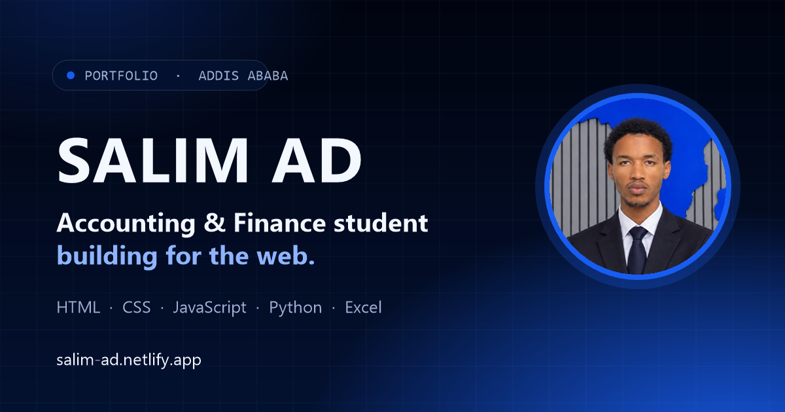

# SALIM AD · Portfolio

My personal portfolio website. I'm a first-year Accounting & Finance student at St. Mary's University in Addis Ababa, learning web development and data analytics.

**Live site:** https://salim-ad.netlify.app

## Built with

- HTML
- CSS (no frameworks)
- JavaScript (no libraries)

Fonts: Geist, Geist Mono and Instrument Serif from Google Fonts.

## Features

- Light and dark themes, remembered between visits
- Responsive layout that works on phones
- Skills shown as a "balance sheet", with bars that fill as you scroll
- Live clock showing the time in Addis Ababa
- Scroll animations, which switch off for people who prefer reduced motion
- Link preview image and tab icon

## Files

| File | What it does |
|---|---|
| `index.html` | The page content |
| `style.css` | All the styling, with the color palette at the top |
| `script.js` | Theme toggle, mobile menu, animations, clock |
| `me.jpg` | Profile photo |
| `og-image.png` | Image shown when the link is shared |
| `favicon.svg`, `favicon-32.png`, `apple-touch-icon.png` | Tab and home-screen icons |

## Run it locally

Download the files and open `index.html` in a browser.
